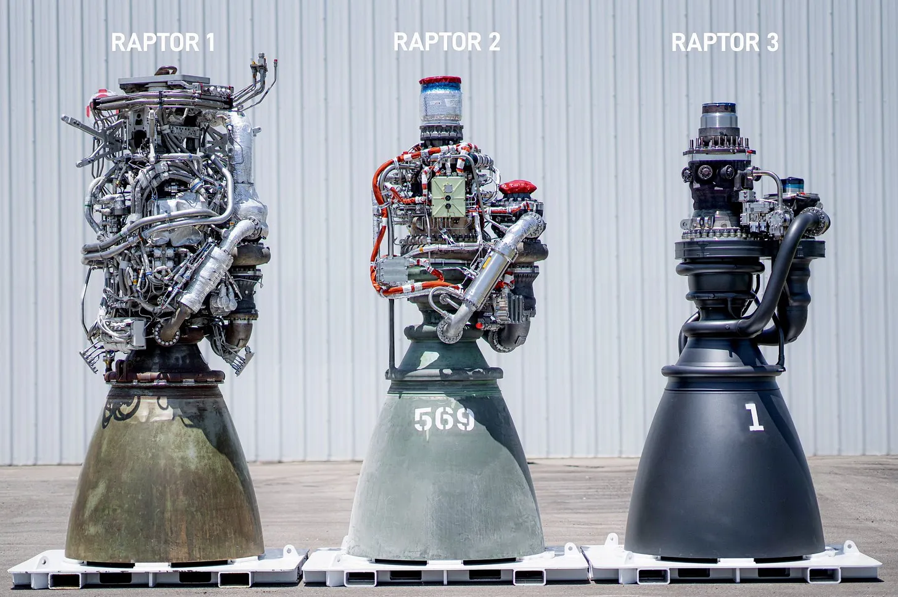

# Raptor Refactor



*Raptor 1 → 2 → 3: тяга выросла, масса упала, обвязка ушла внутрь.
Фото: SpaceX.*

Скилл для любой нейросети и среды: рефакторинг проекта по принципу
совершенствования двигателей SpaceX Raptor. Не «сделать красиво», а
одновременно **поднять полезную способность** и **снизить массу системы**.

Публичный репозиторий: https://github.com/seshmonke/raptor-refactor

> Не аффилирован со SpaceX. Raptor — название двигателя; здесь его эволюция
> используется как инженерная метафора, а не как официальная методология.

## Идея

SpaceX прошла путь Raptor 1 → 2 → 3: тяга выросла примерно с 185 до
250–280 tf, масса двигателя упала с 2 080 до 1 525 кг, а снаружи почти не
осталось трубок и датчиков — лишнее удалили, нужное встроили в конструкцию.
На уровне машины экономия ещё больше: с обвязкой и креплениями Raptor 3
легче Raptor 2 более чем на тонну на двигатель.

Для проекта это означает:

- **Тяга** — работа, которую система делает для пользователя.
- **Масса** — код, тесты, конфиги, зависимости, экраны, шаги, документы,
  поддержка, когнитивная нагрузка.
- **Обвязка** — торчащие наружу скрипты, адаптеры, ручные проверки,
  дашборды, «временные» обходы.
- **Теплозащита** — защита от проблемы, которую можно устранить, вместо
  устранения причины.

Цель — не меньше строк, а больше тяги на единицу массы. И не «когда-нибудь
почистим», а каждая генерация одновременно лучше по возможностям и проще
по конструкции.

## Что внутри

- `SKILL.md` — полная инструкция: философия, семь правил, процесс
  Raptor 2/3/4, поиск находок, замер «до / после», границы, форматы
  отчётов, анти-паттерны.
- `PROMPT.md` — короткий промпт для ChatGPT, Claude, Gemini, локальных
  моделей и любых сред без поддержки скиллов.
- `README.md` — это описание, установка и кейс.

Кода нет: только инструкции.

## Установка

### OpenCode / Claude / совместимые скиллы

Глобально:

```sh
mkdir -p ~/.agents/skills/raptor-refactor
cp SKILL.md ~/.agents/skills/raptor-refactor/
```

В проект:

```sh
mkdir -p .opencode/skill/raptor-refactor
cp SKILL.md .opencode/skill/raptor-refactor/
```

### Любая нейросеть

Вставь `PROMPT.md` в системные инструкции, project rules или в начало
чата. Если среда поддерживает длинные инструкции — используй `SKILL.md`
целиком.

### Среда без доступа к репозиторию

Дай модели:

1. дерево проекта и главные entry points;
2. команду проверки (тесты, линтеры, сборка);
3. 1–3 главных сценария;
4. базу «до»: числа, шаги, время, размер, зависимости;
5. что нельзя ломать.

Дальше — режим `Chat-only`: модель работает как аналитик и выдаёт план,
находки и критерии, но не делает вид, что измерила.

## Быстрый старт

Выбери режим и скажи одной фразой:

- **Ревью:** «Проведи Raptor-ревью проекта. Ничего не меняй: сценарии,
  инвентаризация, находки, замер “до”».
- **Удаление:** «Сделай Raptor 2 по этому реестру находок: только удаления,
  без новых функций».
- **Упрощение:** «Сделай Raptor 3: сверни слои, убери дубли, встрой обвязку,
  не меняя поведения».
- **Ускорение:** «Сделай Raptor 4: ускорь только выжившее, с замером».
- **Полный цикл:** «Веди полный Raptor-цикл: база → ревью → R2 → R3 →
  замер → ретро».
- **Проверка:** «Сыграй адвоката дьявола: где мы удаляем нужное, где
  метрика врёт, где сложность переехала».

## Режимы

| Режим | Что делает | Чего не делает |
|---|---|---|
| Raptor review | Читает, инвентаризирует, измеряет, пишет находки | Ничего не меняет |
| Raptor 2 | Удаляет мёртвое, дубли, элементы без хозяина | Не добавляет функции |
| Raptor 3 | Упрощает, интегрирует, убирает лишнюю защиту | Не оптимизирует раньше времени |
| Raptor 4 | Ускоряет выжившее по измерению | Не трогает то, что надо удалить |
| Full campaign | 2–3 генерации с замером и фиксацией | Не делает всё одним PR |
| Adversarial review | Ищет риски, ложные упрощения, ошибки метрики | Не защищает найденное |

## Чему учит кейс toodoo.tech

Скилл вырос из двух проходов Raptor в проекте toodoo.tech — планировщике
задач с web-интерфейсом. Первый проход (Raptor 1 → 2) удалял и совмещал,
второй (Raptor 2 → 3) добивал тяжёлые экраны до числовых целей.

Что получилось:

| Экран / сценарий | До | После | Итог |
|---|---:|---:|---|
| «Сегодня», весь слой | 38 / 42 | 23 / 38 | решение «Со вчера» одно на группу |
| «Проекты» | 38 | 24 | −37%, ориентир ≤ 26 взят |
| «Доступно» | 37 | 34 | −8%, цель «в окне» не взята, принята владельцем |
| Доска | 120 | 66 | −45%, ориентир ≤ 84 взят |
| Карта | 24 | 21 | −12,5%, цель ≤ 16 не взята, исключение |
| Карточка задачи | 21 | 15 | −29%, до цели ≤ 14 не хватило одного элемента |
| Карточка элемента | 16 | 10 | −38%, цель взята |
| «Завести проект» | 12 шагов | 9 шагов | путь короче |

Числа — интерактивные / информационные элементы в окне; для части
экранов — весь слой. Подробности и условия замера — в самом проекте.

### Уроки, которые вошли в скилл

1. **Ревью и рефакторинг — разные проходы.** Ревью ничего не правит.
   Иначе находки подгоняются под уже сделанные изменения.
2. **Находка — это глагол и приоритет.** «Удалить», «спрятать»,
   «совместить», «убрать потребность». Без глагола это не задача, а
   мнение.
3. **Удаления первыми.** Первый проход дал больше всего не от «красивых»
   улучшений, а от снятия повторов, лишних кнопок и путей.
4. **Цель — от пола, не от процента.** Для списка из восьми строк «минус
   30%» может быть физически недостижим. Проценты без пола приводят к
   удалению нужного.
5. **Сравнимость важнее числа.** Если изменился сид, правило счёта или
   вьюпорт — «до» нужно перемерить заново. Иначе сравнение врёт.
6. **«В окне» — это реально видимое.** Элемент под подвалом шита или в
   прокрутке не считается видимым. Иначе метрика льстит.
7. **Критерий должен быть проверяемым.** Число шагов, «e2e: меньше 7»,
   «в окне не больше 26» — всё это должно быть тестом, замером или явным
   ручным чек-листом. Иначе это пожелание.
8. **Путь возврата и отмены — часть сценария.** Дефекты живут не только
   на пути вперёд: отмена, повтор, откат, закрытие шита, повторный тап.
9. **Интеграция может создать регрессию доступности.** Скрытие пустого
   блока увело фокус — автоматика не поймала, поймал живой проход.
10. **Синтетический жест — не живой жест.** Долгое касание, свайп,
    щипок, drag в iOS Safari нужно проверять руками.
11. **Не переноси массу в соседний слой.** Спрятал поле в шит — измерь и
    шит. Иначе «упрощение» окажется перекладыванием.

## Источники

- SpaceX Raptor — Wikipedia:
  https://en.wikipedia.org/wiki/SpaceX_Raptor
- SpaceX Starship — Wikipedia:
  https://en.wikipedia.org/wiki/SpaceX_Starship
- Raptor 3: lighter, less complicated, yet more powerful:
  https://www.teslaoracle.com/?p=48057
- SpaceX Raptor 3 and the next step in Starship propulsion:
  https://www.newspaceeconomy.ca/2026/04/16/spacex-raptor-3-engines-and-the-next-step-in-starship-propulsion/
- Walter Isaacson, «Elon Musk» (2023) — пятишаговый алгоритм:
  требования → удаление → упрощение → ускорение → автоматизация:
  <https://en.wikipedia.org/wiki/Elon_Musk_(Isaacson_book)>
- NN/g, прогрессивное раскрытие:
  https://www.nngroup.com/articles/progressive-disclosure/
- NN/g, десять эвристик:
  https://www.nngroup.com/articles/ten-usability-heuristics/

Цифры Raptor в публичных источниках различаются по датам и версиям.
В скилле важен вектор: **тяга вверх, масса вниз, обвязка внутрь,
сложность не перекладывается**.

## Лицензия

Текст и инструкции — [MIT](LICENSE).

Изображение `assets/raptor-1-2-3.webp` принадлежит SpaceX и используется
как иллюстрация; лицензия MIT на него не распространяется.
